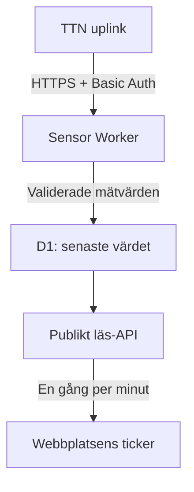

# Koppla sensortickern till The Things Network

## Vad som redan finns

Layout, ticker, pausknapp, stöd för minskad rörelse och mobilplacering finns i
webbplatsen. Utan `PUBLIC_SENSOR_FEED_URL` visas fasta exempel tydligt märkta
**Demo data**. De simulerar varken nya paket eller aktuella tidpunkter.

TTN-bryggan är förberedd men inte publicerad eller ansluten till ditt konto.
Bloggen kör redan på **Cloudflare Workers**, inte Pages. Vi behåller dess
konfiguration och lägger sensorbryggan i en separat Worker.

## Rekommenderad koppling

TTN skickar ett JSON-meddelande via HTTPS när en uplink kommer in. Bryggan
autentiserar avsändaren, väljer tillåtna mätvärden och sparar det senaste värdet
per mätning i D1. Webbplatsen hämtar den offentliga sammanställningen varje minut.



Ingen MQTT-anslutning behöver hållas öppen. Rörelsen i tickern är oberoende av
hur ofta sensorerna rapporterar. En tvåtimmarssensor kan alltså samsas med en
temperatursensor utan att se trasig ut. Detta är ett senaste-värde-flöde, inte
ett historikarkiv. För historik eller larm behövs en separat lösning.

## 1. Förbered lokalt

Efter att layoutens pull request har slagits ihop, kör från repots rot i PowerShell:

```powershell
git pull
npm ci
npx wrangler login
Copy-Item sensor-bridge/wrangler.example.jsonc sensor-bridge/wrangler.jsonc
Copy-Item sensor-bridge/devices.example.json sensor-bridge/devices.json
npx wrangler d1 create johan-sensors
```

Det sista kommandot skapar en resurs i ditt Cloudflare-konto. Kontrollera kontot
och aktuella kvoter/priser innan du fortsätter. Sätt det returnerade databas-ID:t
i `sensor-bridge/wrangler.jsonc`. Ändra inte webbplatsens `wrangler.jsonc`.

```powershell
npx wrangler d1 execute johan-sensors --remote --file sensor-bridge/schema.sql --config sensor-bridge/wrangler.jsonc
npx wrangler deploy --config sensor-bridge/wrangler.jsonc
```

Spara den Worker-URL som kommandot visar, exempelvis
`https://johan-sensor-bridge.DITT-KONTO.workers.dev`. Innan hemligheter är satta
avvisar bryggan uplinks och det publika API:t visar inga mätvärden.

## 2. Välj vad som får publiceras

Öppna `sensor-bridge/devices.json`. Ange TTN-applikationens ID och enhetens ID
(inte dess visningsnamn). Matcha `fields[].key` mot nycklarna i enhetens
`uplink_message.decoded_payload` i TTN Live data.

- `alias`: ett neutralt, publikt namn, exempelvis `NODE 01`.
- `key`: exakt nyckel i det avkodade payloadet, exempelvis `temperature`.
- `label` och `unit`: hur mätningen visas.
- `min` / `max`: valfria rimlighetsgränser i den angivna enheten.
- `staleAfterSeconds`: efter hur lång tid mätningen märks `stale`.

Exempel: 900 sekunder för en sensor som normalt rapporterar var femte minut;
21600 sekunder för en vattennivåsensor som rapporterar varannan timme.
Enheten konverteras inte automatiskt: millivolt måste avkodas till volt eller
märkas `mV`. Versionen stöder numeriska fält på första nivån; booleska eller
nästlade värden behöver normaliseras i TTN-dekodern eller i `normalize.mjs`.

Lägg flera fält under samma enhet eller fler enhetsobjekt i listan. Ingen ändring
av layouten behövs. Maximalt 20 enheter och 40 mätningar tillåts. Kombinationen
alias + fältnyckel måste vara unik. Undvik privata uppgifter även i fältnycklarna,
eftersom dessa ingår i det publika mät-ID:t.

Ladda upp konfigurationen som serverhemlighet:

```powershell
Get-Content sensor-bridge/devices.json -Raw | npx wrangler secret put SENSOR_DEVICES --config sensor-bridge/wrangler.jsonc
npx wrangler secret put TTN_WEBHOOK_SECRET --config sensor-bridge/wrangler.jsonc
```

För `TTN_WEBHOOK_SECRET`: skapa ett slumpmässigt lösenord i din lösenordshanterare
(minst 32 ASCII-tecken, gärna 48–64), klistra in vid uppmaningen och spara det
för TTN-steget. Detta är en separat webhookhemlighet, **inte** en TTN API-nyckel.
Lägg aldrig hemligheten i Git, en URL eller en `PUBLIC_`-variabel.
Lokala konfigurationsfiler är git-ignorerade.

## 3. Skapa webhooken i TTN

I TTN Console, öppna rätt applikation:

1. **Integrations → Webhooks → Add webhook → Custom webhook**.
2. Webhook ID: exempelvis `field-notes`.
3. Format: **JSON**.
4. Base URL: din sensor-Workers URL, utan avslutande sökväg.
5. Aktivera bara **Uplink message** och sätt dess sökväg till `/ttn/uplink`.
6. Aktivera **Request authentication** (HTTP Basic Auth).
7. Username: `ttn`. Password: samma värde som `TTN_WEBHOOK_SECRET`.
8. Lämna **Downlink API key** tom: webbplatsen ska inte styra enheterna.

Payloadformatteraren måste leverera numeriska värden i `decoded_payload`.
Om du använder webhookens fältfilter måste `end_device_ids`, `received_at` och
`uplink_message.decoded_payload` finnas kvar. Bryggan använder `received_at`
som mottagningstid, inte en uppfunnen sensorklocka.

## 4. Kontrollera innan tickern växlas till live

Vänta på nästa ordinarie uplink (eller använd enhetens säkra testfunktion).
Kontrollera TTN:s webhookhändelser: lyckad leverans ska ge HTTP 200.

```powershell
Invoke-RestMethod https://johan-sensor-bridge.DITT-KONTO.workers.dev/api/sensors
```

Svaret ska innehålla `readings` med namn, värde, enhet, anonymt nodnamn och
tidpunkt. Ingen rå TTN-payload, position, DevEUI eller nyckel ska visas.
Ett tomt `readings` trots HTTP 200 betyder vanligen fel application/device-ID,
saknad avkodning eller fel fältnamn. Okända enheter/fält kvitteras men publiceras inte.

## 5. Aktivera på webbplatsen

I **bloggens Cloudflare-bygginställningar**, lägg till en byggmiljövariabel:

```text
PUBLIC_SENSOR_FEED_URL=https://johan-sensor-bridge.DITT-KONTO.workers.dev/api/sensors
```

Gör sedan en ny build/deployment av bloggen. Variabeln läses när Astro bygger
sidan; att enbart lägga den som runtime-secret räcker inte. URL:en är avsiktligt
offentlig och innehåller ingen hemlighet.

Efter publicering ska etiketten vara `Latest readings`, inte `Demo data`.
Vid avbrott visas `Offline · last readings` eller `Feed unavailable`. När alla
mätningar blivit gamla visas `Readings delayed`. Varje mätning har egen ålder.
Inga demovärden ersätter misslyckade liveanrop.

## Drift, säkerhet och begränsningar

- D1 lagrar bara senaste mätningen per publikt ID. Dubbletter eller äldre paket
  får inte skriva över nyare värden. Ingen lång historik byggs upp.
- Mätningar äldre än sju dagar döljs i API:t; de raderas inte automatiskt ur D1.
- Endast tillåtna numeriska värden publiceras. Borttagna enheter filtreras bort
  även om tidigare värden finns kvar i databasen. Byt alias/ID om du ändrar en
  mätnings enhet eller betydelse, så gamla värden inte omtolkas.
- Läs-API:t är avsiktligt publikt med CORS `*`, utan cookies. Publicera bara
  ofarliga mätningar; även temperatur och energiförbrukning kan röja beteenden.
- Browsern hämtar var 60:e sekund; HTTP-cache tillåter 30 sekunder. Detta är inte
  sekundsnabb realtid. Inaktiva flikar pausar hämtningar och rörelse.
- Payloaden begränsas till 32 KB. Bryggan loggar inte inkommande JSON.
- Vid större trafik: använd Cloudflares rate limiting och följ Workers/D1-usage.
  Webhookhemligheten skyddar skrivning men ersätter inte trafikbegränsning.
- Utgå inte från garanterad leverans eller automatiska webhook-retries på alla
  TTN-planer. Nästa uplink återställer normalt senaste värdet; larm kräver mer.
- Återgå till demo genom att ta bort byggvariabeln och bygga om. Koppla bort
  webhooken i TTN separat om den ska sluta skicka data.

## Tester och källor

`npm test` kontrollerar normalisering, sekretess, autentisering, felhantering,
dubbletter och ordning med riktig SQLite i minne. `npm run build` bygger Astro.
Det ersätter inte ett verkligt uplink-test med ditt TTN-/Cloudflare-konto.

- [TTN: skapa webhooks](https://www.thethingsindustries.com/docs/integrations/webhooks/creating-webhooks/)
- [Cloudflare: Worker secrets](https://developers.cloudflare.com/workers/configuration/secrets/)
- [Cloudflare: D1 prepared statements](https://developers.cloudflare.com/d1/worker-api/prepared-statements/)
